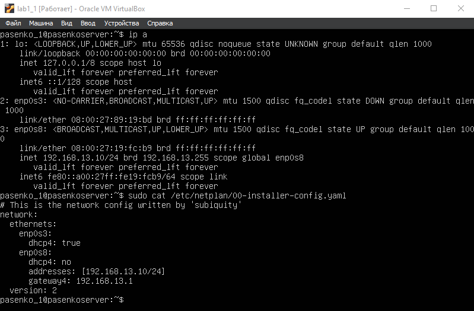
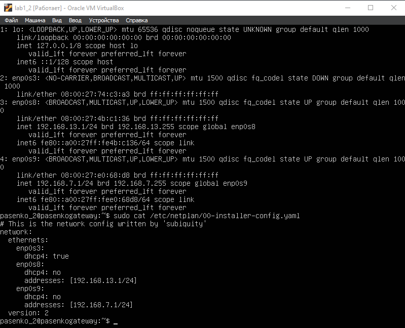
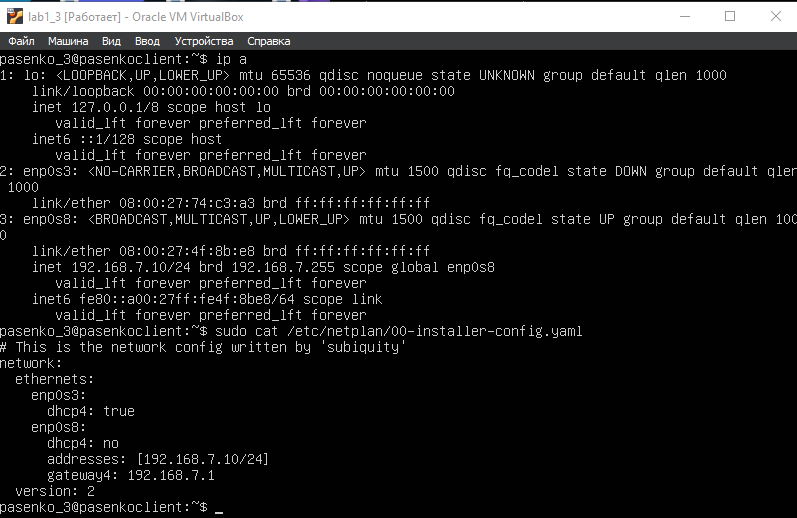
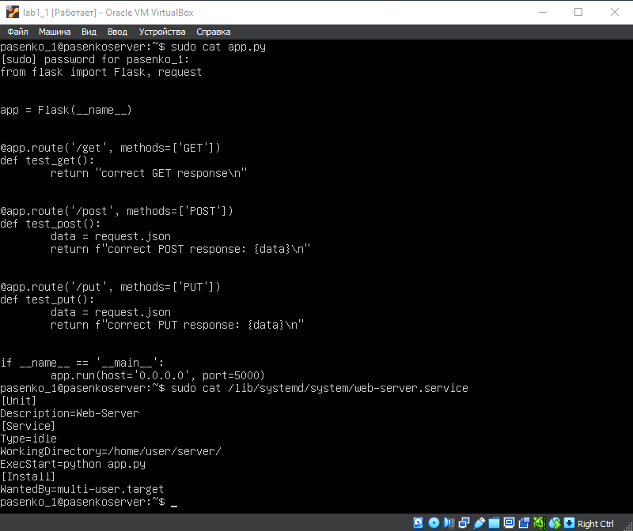
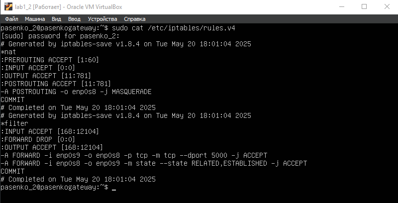
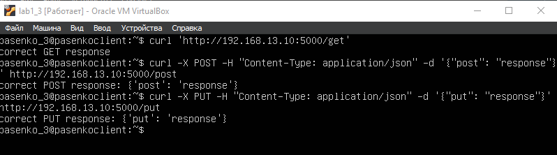
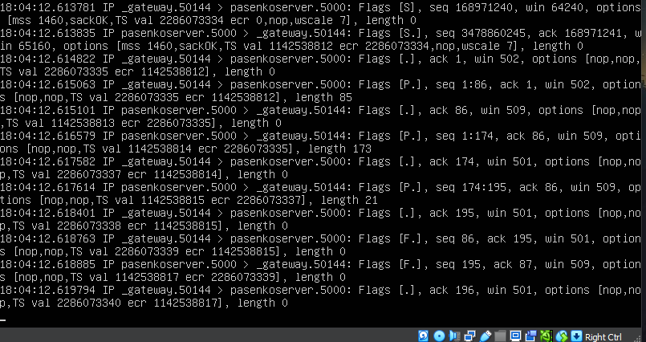
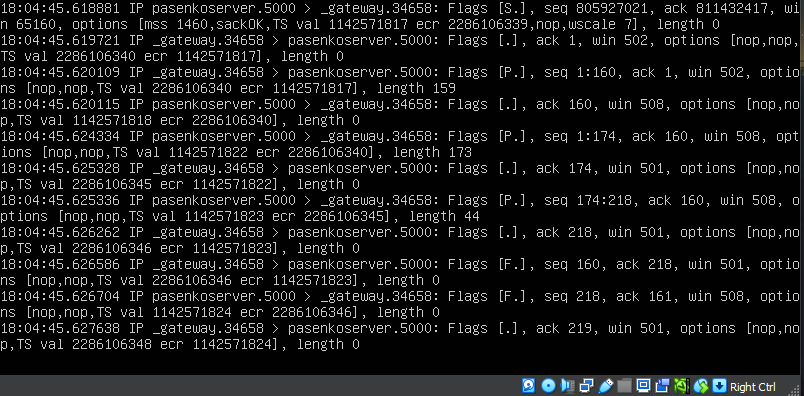
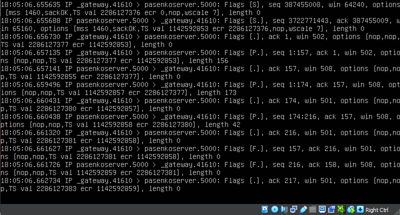

# Отчёт по работе №1: Практика Linux (VirtualBox)

## Создание виртуальной машины
1. Создаём виртуальную машину на основе образа <ins>Ubuntu Server</ins>.
2. Клонируем её дважды и настраиваем сетевые адаптеры согласно заданию.
3. Запускаем все три машины и меняем на них hostname и user согласно заданию:
```shell
    1. user=pasenko_1, hostname=pasenkoserver для vmA (server);
    2. user=pasenko_2, hostname=pasenkogateway для vmB (gateway);
    3. user=pasenko_3, hostname=pasenkoclient для vmC (client);
```

## Настройка netplan конфигов
1. Меняем netplan конфиги согласно заданию.
2. Применяем их при помощи:
```shell
sudo netplan apply
```
3. После настройки получаем:





Сами конфиги находятся в configs/, а скриншоты со всех VM в pictures/.

## Настройка VMs по отдельности
1. Начнём с vmA:
    1. В app.py *(код приложен в application/)* создаём Flask приложение с тремя эндпоинтами (/get, /post, /put).
    2. Под приложение пишем сервис, который будет запускать его через автозагрузку.



2. Перейдем к vmB:
Настраиваем iptables для маршрута пакетов от vmA до vmC и фильтрации пакетов по порту 5000.



## Тестирование
1. Запустим приложение на vmA *(важно проверить, на каких адресах оно работает)*:
```shell
python3 app.py
```
2. Попробуем отправить запрос с vmC по всем роутам для проверки:



Как можно увидеть, vmA успешно отправляет ответ по всем видам запросов.
Дополнительно проверим логи передачи пакетов с vmC на vmA при помощи <ins>tcpdump</ins>:





Представленные скриншоты подтверждают работоспособность системы: все виртуальные машины успешно настроены, связь и фильтрация пакетов налажена, а Flask приложение отрабатывает все запросы.