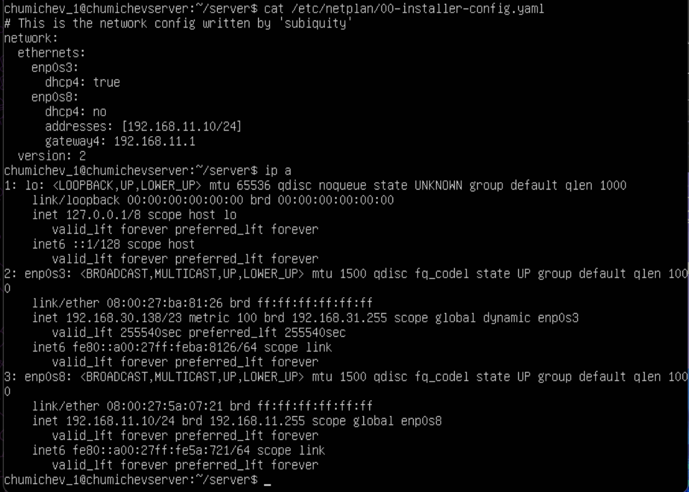
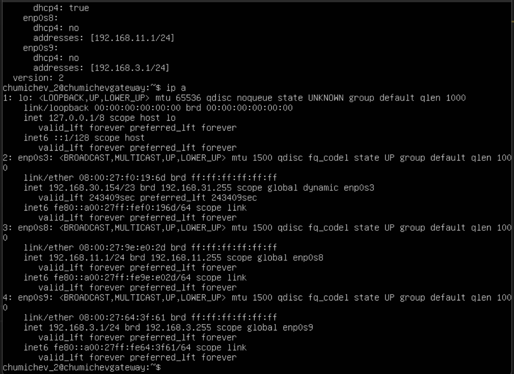
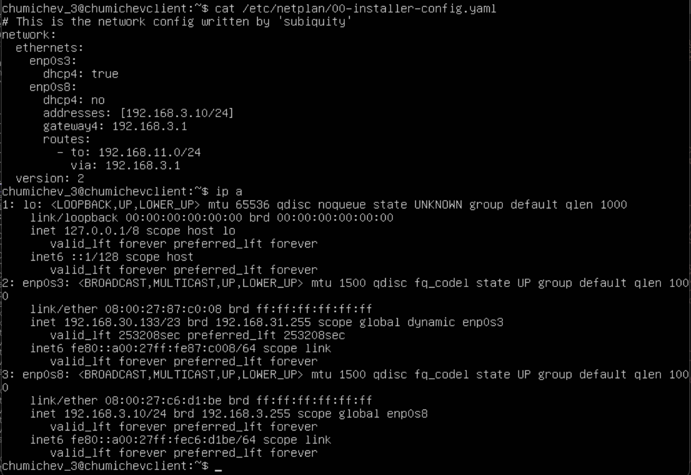
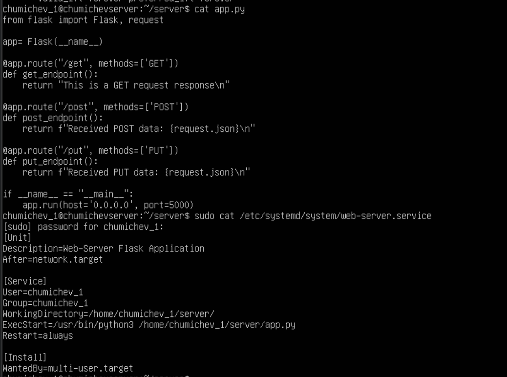
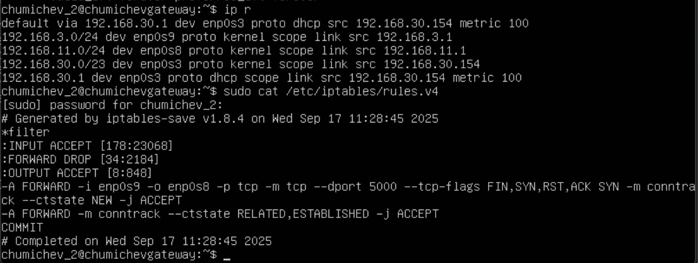
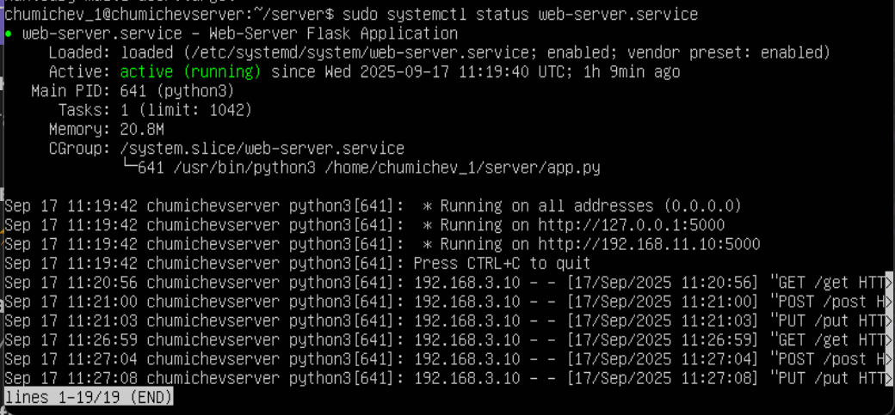
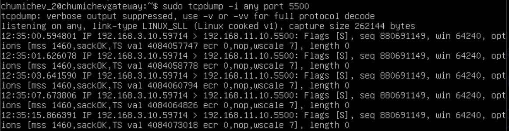
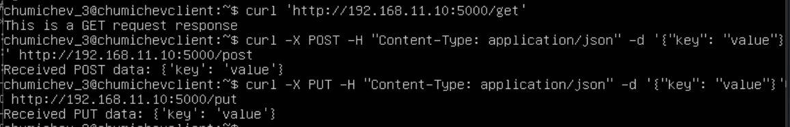
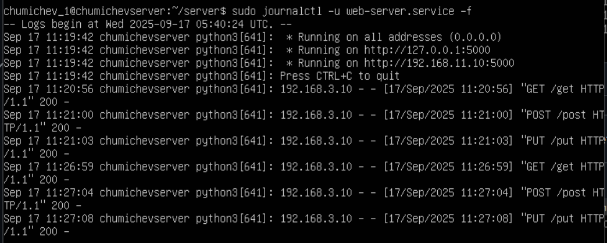

@@ -0,0 +1,68 @@
# Отчёт по работе №1: Практика Linux (VirtualBox)

<br>

**Чумичев Вячеслав Алексеевич** 

<br>

**Дата рождения: 11.03.2002**

<br>

## 1. Создание ВМ
Начинаем работу с создания одной ВМ на основе скачанного образа. Дважды клонируем её. <br>
Далее настраиваем сетевые адаптеры по заданию:
- Вместо NAT - Сетевой мост
- Добавляем две внутренние подсети - `clientnet` и `servernet` <br> <br>

После настройки запускаем все три ВМ и конфигурируем hostname и user:
- `user=chumichev_1, hostname=chumichev_server (server)`
- `user=chumichev_2, hostname=chumichev_gateway (gateway)`
- `user=chumichev_3, hostname=chumichev_client (client)`

## 2. Конфигурация netplan
Перейдем к настройке netplan конфигов. <br>
Меняем конфигурационные файлы командой:
```shell
sudo nano /etc/netplan/00-installer-config.yaml
```
А также применяем новые сетевые настройки:
```shell
sudo netplan apply
```
Проверим полученный результат: <br>





## 3. Индивидуальная настройка ВМ
### Linux A (server)
В корневой папке создадим файл `app.py` с простым Flask приложением на три эндпоинта. <br>
Также напишем сервис для автозапуска приложения:



### Linux B (gateway)
Настроим `iptables` на ВМ-шлюзе для фильтрации пакетов по 5000 порту. <br>
Делаем это также через терминал командами по заданию. <br>
После изменения сохраняем конфигурацию через `iptables-persistent`. <br>
Проверим полученный результат: <br>



## 4. Тестирование всей системы
Для проверки всей системы необходимо:
- Проверить работу web-service `app.py` на машине **А**



- Запустить `tcpdump` на машине **B** и проверить работу firewall



- Начать отправлять `curl` запросы на машине **C**
Проверим полученный результат: <br>



